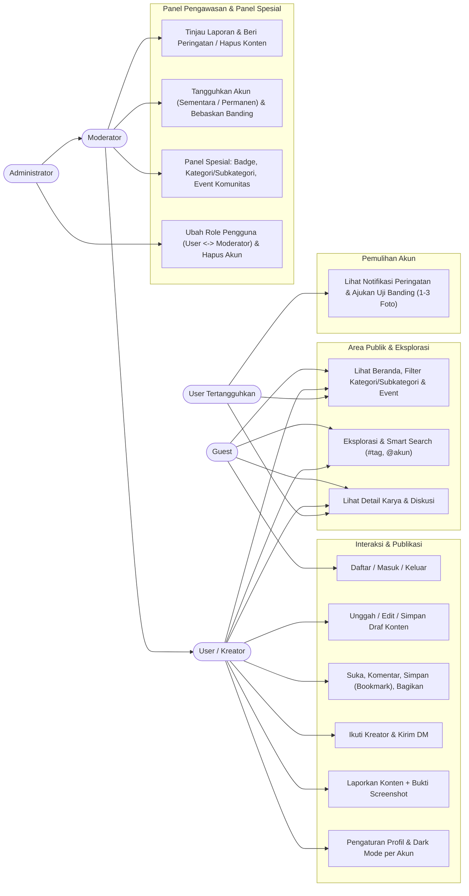

# Dokumen Use Case — BedahKarya

Dokumen ini menjelaskan aktor, hak akses, dan skenario fungsional utama pada aplikasi **BedahKarya**.

---

## 1. Daftar Aktor

| Aktor | Peran (`Role`) | Deskripsi Singkat |
| --- | --- | --- |
| **Tamu** | `Guest` (Belum Login) | Dapat membaca konten publik, menjelajah kategori/subkategori, melihat profil, dan melihat event. Tidak dapat berinteraksi atau mengunggah. |
| **Kreator / Pengguna** | `USER` | Dapat mengunggah konten/draf, menyukai, berkomentar, menyimpan (bookmark), mengikuti akun lain, mengirim DM ke akun yang diikuti, melapor, dan mengatur preferensi akun. |
| **Pengguna Tertangguhkan** | `USER` (`isSuspended = true`) | Tetap dapat masuk dalam **mode baca saja** (*read-only*), melihat notifikasi peringatan, serta mengajukan **Uji Banding** dengan 1–3 foto bukti. |
| **Moderator** | `MODERATOR` | Memiliki seluruh hak `USER` ditambah akses Panel Pengawasan (`/admin`) untuk meninjau laporan, memberi peringatan/menghapus konten, menangguhkan akun, memproses Uji Banding, serta mengelola **Panel Spesial** (Badge, Kategori/Subkategori, Event). |
| **Administrator** | `ADMIN` | Memiliki kontrol penuh sistem termasuk mengubah peran pengguna menjadi `MODERATOR`/`USER`, menghapus akun, dan seluruh fitur Moderator. |

---

## 2. Diagram Use Case

---

## 3. Spesifikasi Use Case Utama

### UC-01: Autentikasi Pengguna (`/login`, `/register`)
- **Aktor**: Guest, User
- **Alur Utama**:
  1. Pengguna mendaftar menggunakan nama, username unik, email, nomor HP, dan kata sandi (minimal 6 karakter).
  2. Saat masuk, pengguna bisa memakai email atau username dan memilih opsi *Ingat Saya* (sesi 30 hari vs 1 hari).
  3. Password di-hash menggunakan `bcryptjs` dan token sesi disimpan dalam cookie `HttpOnly` JWT.

### UC-02: Jelajah Beranda & Filter Kategori/Subkategori (`/`)
- **Aktor**: Semua aktor
- **Alur Utama**:
  1. Pengunjung memilih tab **Untuk Anda** atau **Mengikuti**.
  2. Pengunjung memfilter konten berdasarkan **Kategori Konten** dan **Subkategori** yang muncul dinamis di bawahnya.
  3. Menggulir ke bawah memicu pemuatan otomatis (*infinite scroll*); menarik/gulir ke atas menyegarkan daftar konten.

### UC-03: Smart Search & Eksplorasi (`/search`)
- **Aktor**: Semua aktor
- **Alur Utama**:
  1. Mengetik di kolom pencarian memunculkan panel dropdown berisi maksimal **5 riwayat pencarian** dan **tren pencarian terbanyak**.
  2. Awalan `@` memunculkan saran pengguna (prioritas akun yang diikuti).
  3. Awalan `#` memunculkan tag populer (*case-insensitive*) untuk memfilter karya terkait.

### UC-04: Unggah & Kelola Draf Konten (`/upload`)
- **Aktor**: User aktif (tidak tertangguhkan)
- **Alur Utama**:
  1. Kreator mengisi judul (wajib bebas tautan/URL), memilih **Kategori**, **Subkategori (opsional)**, dan **Event Komunitas (opsional)**.
  2. Kreator memilih mode **Gambar** (crop/zoom/pan `4:5` Portrait atau `16:9` Landscape, atau frame utuh `#1E293B`) atau **Hanya Teks** (`#CBD5E1`).
  3. Kreator mengisi deskripsi (50–2.200 karakter / maks. 500 kata untuk publikasi), tag `#`, `@mentions`, tautan eksternal, dan opsi sembunyikan jumlah suka.
  4. Kreator memilih **Simpan Draf** (tersimpan di tab Draf profil) atau **Publikasikan**.

### UC-05: Detail Karya, Caption 1-Klik, Tautan Aman & Bagikan (`/post/[id]`)
- **Aktor**: Semua aktor
- **Alur Utama**:
  1. Karya *Landscape* ditampilkan dengan profil & diskusi di bawahnya; *Portrait/Teks* di sebelah kanan.
  2. Menekan tombol **Caption** (1 klik) membuka modal detail berisi judul, pembuat + badge, waktu upload, deskripsi, tautan eksternal, kategori, subkategori, event, dan tag yang dapat diklik.
  3. Menekan tautan eksternal memunculkan modal peringatan keamanan sebelum meninggalkan BedahKarya.
  4. Menekan **Bagikan** menyediakan salin tautan, WhatsApp, dan Telegram.

### UC-06: Ulasan Konstruktif & Pengaturan Profil (`/profile/[username]`, `/settings`)
- **Aktor**: User aktif
- **Alur Utama**:
  1. Pengguna menulis komentar; pemilik karya atau staff dapat menandai komentar sebagai **Ulasan Konstruktif** untuk menambah reputasi penulis komentar.
  2. Pada tab profil terdapat **Konten Sendiri**, **Disimpan** (bookmark), dan **Draf** (khusus pemilik akun).
  3. Pada halaman **Pengaturan**, pengguna dapat mengganti **Tema Terang/Gelap** khusus untuk akun tersebut, menyembunyikan jumlah suka secara bawaan, serta mengatur izin DM.

### UC-07: Pesan Langsung / DM (`/messages`)
- **Aktor**: User aktif
- **Alur Utama**:
  1. Pengguna hanya dapat mengirim DM ke kreator yang sudah **diikuti** (dan mengizinkan DM).
  2. Pesan mendukung teks, lampiran gambar, maupun *share/reply* karya langsung ke percakapan DM.

### UC-08: Pelaporan Konten & Moderasi (`/admin/reports`, `/admin/contents`)
- **Aktor**: User (pelapor), Moderator & Admin (peninjau)
- **Alur Utama**:
  1. User melaporkan konten dengan alasan terstruktur dan opsional unggah screenshot bukti.
  2. Moderator/Admin meninjau laporan, dapat memberi **Peringatan 1–2x** pada konten, menandai **Pelanggaran**, atau menghapus konten.

### UC-09: Penangguhan Akun & Uji Banding (`/appeal`, `/admin/users`, `/admin/appeals`)
- **Aktor**: User tertangguhkan, Moderator, Admin
- **Alur Utama**:
  1. Moderator/Admin menangguhkan akun (tanpa batas waktu atau dengan durasi hari/bulan/tahun).
  2. Akun tertangguhkan menerima notifikasi peringatan, masuk dalam mode *read-only*, dan dapat mengirim permohonan **Uji Banding** disertai **1–3 foto bukti**.
  3. Moderator/Admin membaca bukti banding dan menekan **Bebaskan** untuk memulihkan status akun, atau **Tolak**.

### UC-10: Panel Spesial (`/admin/special`)
- **Aktor**: Moderator & Admin
- **Alur Utama**:
  1. Membuat badge kustom serta menyematkan/mencabut badge spesial ke akun pengguna (muncul notifikasi + tampil di profil & kartu konten).
  2. Menambah atau menghapus **Kategori** dan **Subkategori Konten** secara dinamis.
  3. Membuat, mengaktifkan/menonaktifkan, atau menghapus **Event Komunitas** (beserta siaran pengumuman otomatis).
