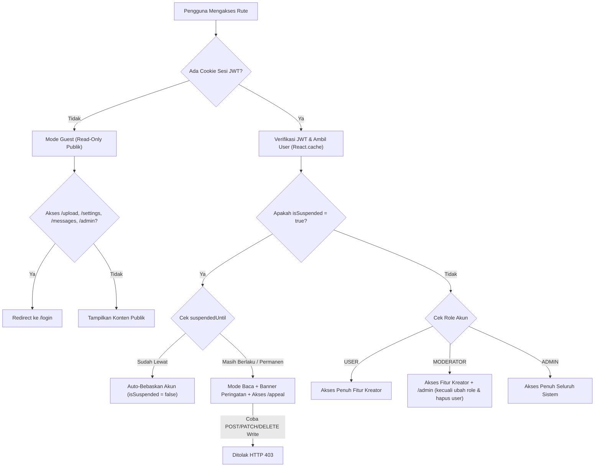
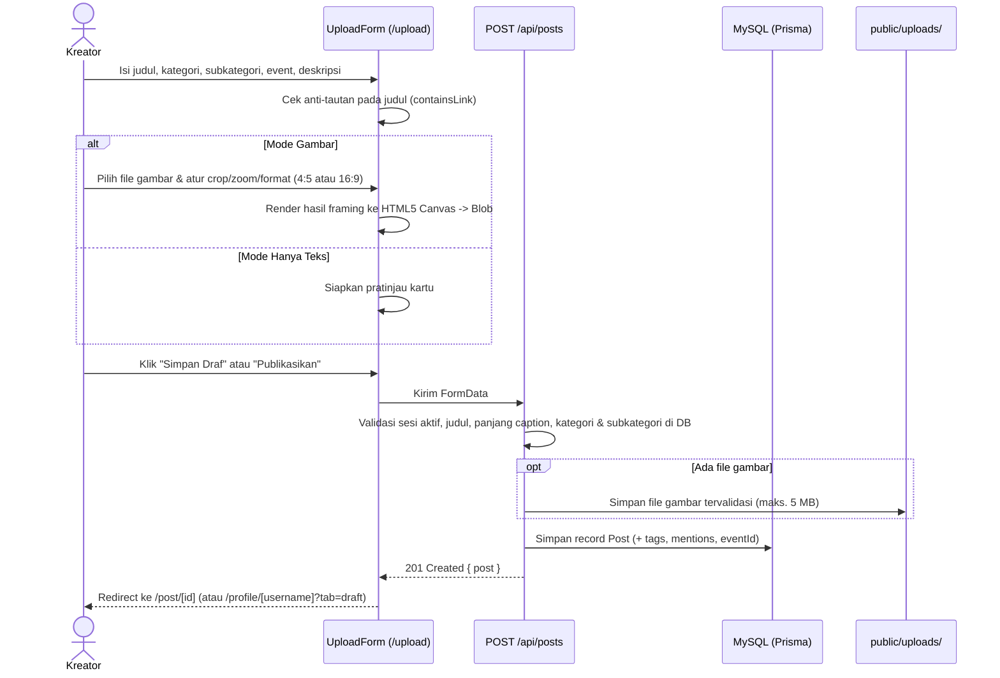
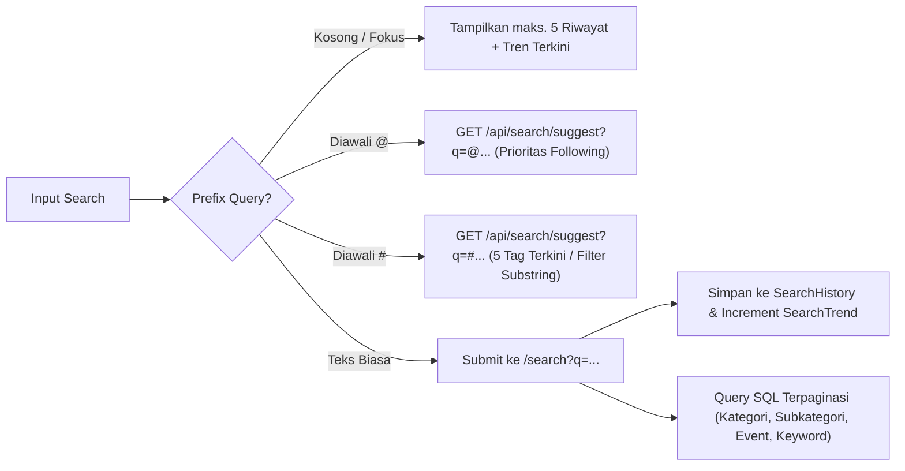
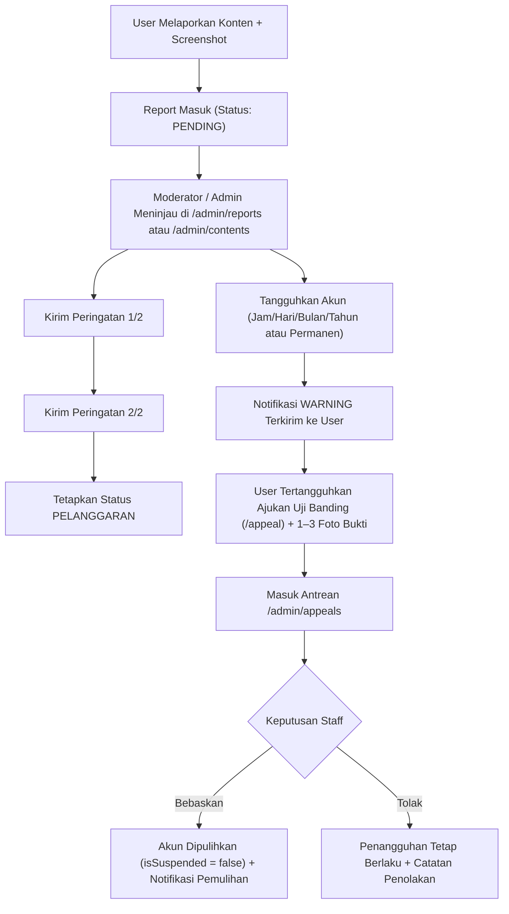
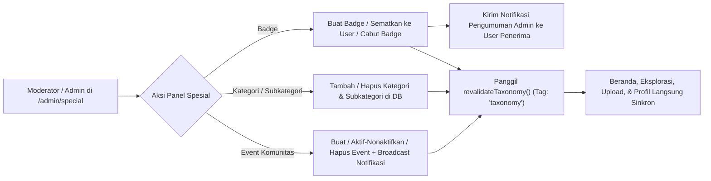

# Dokumen Workflow & Alur Sistem — BedahKarya

Dokumen ini memetakan alur kerja (*workflow*) utama dari sisi pengguna, moderasi, hingga sinkronisasi cache dan database di **BedahKarya**.

---

## 1. Alur Autentikasi & Kontrol Akses (RBAC)

---

## 2. Alur Unggah, Validasi Media, & Publikasi Konten

---

## 3. Alur Pencarian Pintar & Eksplorasi

---

## 4. Alur Pengawasan, Peringatan, & Uji Banding

---

## 5. Alur Panel Spesial & Sinkronisasi Cache (`taxonomy`)

